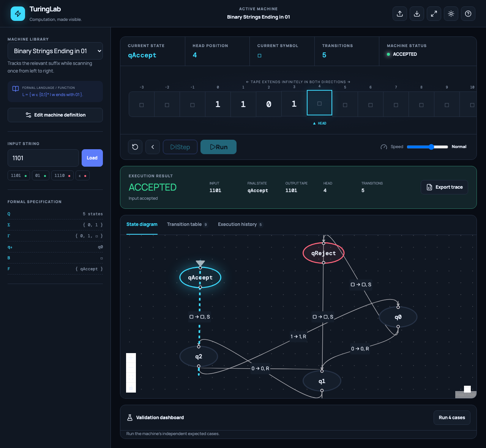
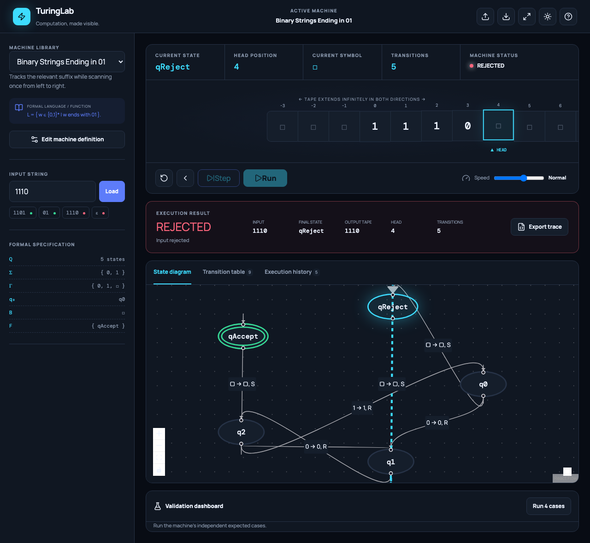

# Design and Development of an Interactive Turing Machine Simulator

**CSET302 — Automata Theory and Computability**  
**M1 — Problem Analysis and Project Design**

| Submission field | Editable value |
|---|---|
| University name | `[University name]` |
| Student name | `[Student name]` |
| Enrollment number | `[Enrollment number]` |
| Faculty name | `[Faculty name]` |
| Academic year | `[Academic year]` |
| Submission date | `[Submission date]` |

## Abstract

TuringLab is an implemented browser application that connects the formal definition of a deterministic Turing machine to an observable computation. A student can select or define a machine, enter a dynamic input, execute one transition at a time or under controlled playback, and inspect the tape, head, state graph, transition table, snapshot history, and final result. A pure TypeScript engine validates the formal seven-tuple, stores an unbounded two-way tape sparsely, and distinguishes acceptance, rejection, a missing-rule `STUCK` condition, and resource-bound exhaustion. Six complete machines and independent automated oracles support correctness validation. The verified prototype demonstrates the required Input → Algorithm → Step-by-Step Visualization → Result → Validation workflow.

## 1 Introduction

A Turing machine models computation with a finite controller, an unbounded tape, and a read/write head. Despite its compact definition, a run quickly becomes difficult to trace because every transition changes a symbol, head position, and state. Static textbook tables describe the rule system but do not continuously expose the active configuration. TuringLab turns that changing configuration into a synchronized, inspectable interface without changing the formal semantics.

## 2 Problem Statement

Students need a way to move from a transition function to the exact sequence of configurations it induces. Manual traces are valuable but error-prone for long inputs, marker-based algorithms, and machines that travel left of the initial cell. The project implements a dynamic educational simulator that validates a deterministic single-tape definition, executes its partial transition function exactly, visualizes each configuration, and compares outcomes with declared test cases.

## 3 Motivation and Problem Selection

Turing machines are central to effective computation, recognizability, decidability, and computability. Manual tracing becomes complex as the head revisits positions and temporary symbols accumulate. Animated movement helps a reader associate a transition rule with its operational effect, while complete history preserves evidence needed to audit that effect. Because an incorrect rule silently changes the recognized language, the engine and example definitions require stronger validation than a visual mock-up.

## 4 Project Objectives

1. Implement `M = (Q, Σ, Γ, δ, q0, B, F)` with explicit accepting and rejecting states.
2. Execute valid inputs reproducibly on a two-way sparse tape, including negative indexes and stationary moves.
3. Synchronize tape, graph, table, history, and result views for every transition.
4. Block invalid definitions and label a missing transition as `STUCK`.
5. Supply six complete classroom machines and validate them with independent oracles.
6. Support local JSON import/export, trace export, and static browser deployment.
7. Verify the exact `1101` ending-in-`01` trace and retain repeatable test evidence.

## 5 Scope

The system supports one deterministic tape, one head, a tape unbounded in both integer directions, a partial transition function, individual-character symbols, movements `L`, `R`, and `S`, explicit accept/reject states, controlled playback, snapshots, machine editing, and bounded automated runs. It does not simulate nondeterministic branches, multiple tapes, oracle machines, or a universal machine encoding. It does not and cannot decide whether every arbitrary machine halts. A practical step limit only ends that simulation attempt with `STEP_LIMIT_REACHED`.

## 6 Formal Automata Specification

The implemented variant is `M = (Q, Σ, Γ, δ, q0, B, F)`, where `Q` is a finite nonempty state set; `Σ` is the input alphabet; `Γ` is the tape alphabet with `Σ ⊆ Γ`; `q0 ∈ Q`; `B ∈ Γ \ Σ` is the blank; and `F ⊆ Q` contains accepting states. The implementation additionally names a disjoint rejecting set `R ⊆ Q`.

`δ : (Q \ (F ∪ R)) × Γ ⇀ Q × Γ × {L, R, S}`

If `δ(q,a) = (p,b,D)`, one step writes `b`, moves left, right, or stays, and enters `p`. Entering `F` accepts; entering `R` rejects. If a nonhalting pair has no rule, the result is `STUCK`, intentionally distinct from rejection. Input begins at cell 0 and all other cells are implicit blanks.

The primary sample uses `Q={q0,q1,q2,qAccept,qReject}`, `Σ={0,1}`, `Γ={0,1,□}`, initial `q0`, `F={qAccept}`, and `R={qReject}`. State `q1` means the current final symbol is `0`; `q2` means the current suffix is `01`. On the right blank, only `q2` accepts.

## 7 Existing Tools and Comparative Analysis

| Tool | Verified published capabilities | TuringLab focus |
|---|---|---|
| JFLAP | Desktop package covering one-tape, multitape, and building-block TMs plus other automata | Browser workflow, explicit runtime semantics, trace export, built-in validation |
| Morphett simulator | Browser program-text simulator associated with a published universal-machine example | Formal JSON model, graph, rewind, explicit outcomes, validation dashboard |
| Open Logic Project visualization | Browser step/pause/reset, highlighted tape/state, editable program, many examples, one-character symbols | Seven-tuple validation, rejecting states, history restore, machine/trace JSON, oracle tests |
| Vassar simulator | Browser tape with table/graph modes, rules, speed, and reset | Integrated configuration, execution evidence, and multi-case validation |

TuringLab does not claim competitors lack features that their official material does not document. Its contribution is a coherent path from a validated seven-tuple through auditable execution to repeatable expected-result validation.

## 8 Feasibility Study

**Technical feasibility.** React and TypeScript express the interface while a framework-independent engine remains directly testable. JavaScript `Map` supports sparse integer tape positions. React Flow supplies graph interaction, and static deployment needs no server.

**Operational feasibility.** A machine library and example inputs reduce setup. Direct controls and explanations preserve the connection to formal rules. JSON enables exchange without accounts.

**Economic feasibility.** All dependencies are open source, storage is local, and the application can use free static hosting. No paid API, database, or authentication is required.

**Schedule feasibility.** Engine, examples, interface, verification, and documentation are modular enough to complete before the 2–6 November 2026 evaluation.

**Risks and mitigation.** Independent oracles and exhaustive short inputs catch faulty example rules. Resource budgets and one cleanup-safe playback loop constrain runaway execution. Every view derives from the same definition and configuration. A bounded viewport and sparse tape limit rendering cost.

## 9 Technology Stack

| Technology | Installed version | Responsibility |
|---|---:|---|
| React / React DOM | 19.3.1 | Component rendering and interaction |
| TypeScript | 5.9.3 | Strict formal types and compiler checks |
| Vite | 8.3.5 | Development and optimized static build |
| Tailwind CSS | 4.3.3 | Utility compiler and compatible Vite styling pipeline |
| React Flow | 12.12.0 | Pan, zoom, drag, nodes, labeled edges |
| Zustand | 5.0.16 | Synchronized simulator state |
| Motion | 12.43.0 | Restrained tape movement animation |
| Lucide React | 0.548.0 | Consistent interface icons |
| Vitest | 4.1.12 | Unit, algorithm, and integration tests |
| Testing Library | 16.3.3 | User-oriented React checks |
| Playwright | 1.64.1 | Chromium workflows and screenshots |
| ESLint | 9.39.5 | Static code-quality gate |

The interface applies shadcn-style reusable button, panel, form, and dialog conventions inside a project-specific CSS-variable design system with dark and light themes.

## 10 System Architecture

The architecture source is [`architecture.mmd`](diagrams/architecture.mmd). User actions pass through input and definition validation into an active configuration. The engine coordinates the sparse tape and snapshot manager. Visualization and result components consume the same configuration, preventing diagram/execution divergence. JSON I/O operates only on validated definitions and recorded histories.

## 11 Software Modules

- **Machine configuration:** states, alphabets, halting sets, transitions, descriptions, examples.
- **Input validator:** rejects characters outside `Σ`.
- **Tape manager:** returns implicit blanks and stores only nonblank cells.
- **Transition engine:** deterministic lookup and exact one-step semantics.
- **Execution controller:** single playback schedule, pause/reset, resource limits.
- **Graph renderer:** nodes and edges derived from the active definition.
- **History manager:** initial and post-step snapshots with restoration.
- **Validation module:** pass, fail, and inconclusive bounded results.
- **Import/export:** validated machine JSON and execution trace downloads.

## 12 Simulator Flowchart

The complete decision flow is in [`execution-flowchart.mmd`](diagrams/execution-flowchart.mmd). It keeps invalid configuration, explicit halting, missing rules, and exhausted budgets as separate branches. A budget result returns no language-membership conclusion.

## 13 UML Diagrams

- Use case diagram: [`use-case.mmd`](diagrams/use-case.mmd)
- Component/class diagram: [`component-class.mmd`](diagrams/component-class.mmd)
- Sequence diagram: [`sequence.mmd`](diagrams/sequence.mmd)

The sequence shows initialization of `1101`, repeated UI → store → engine → sparse-tape calls, snapshot delivery, and the fifth-transition acceptance.

## 14 UI Design and Mock-ups

The desktop layout uses a formal-configuration rail and a computation workspace. The top block presents state, head, symbol, transition count, status, a 15-cell moving viewport, and playback. A result banner precedes graph/table/history tabs and a validation dashboard. On narrow screens the rail stacks above the workspace. Cyan indicates active computation, green acceptance, red rejection/error, and amber resource limits.

**Figure 1. Actual application after accepting `1101`.**



**Figure 2. Actual application after rejecting `1110`.**



These are Playwright captures of the working application, not conceptual mock-ups.

## 15 Algorithm Selection

A deterministic hash lookup matches the mathematical condition that each `(state,symbol)` pair has at most one result. The sparse tape avoids a falsely finite or enormous array and permits negative positions. Each successful step follows: inspect state and symbol; check halting; find rule; write; move; change state; increment; snapshot; check the new state. Rewind uses stored snapshots because an arbitrary transition need not be invertible.

## 16 Pseudocode

```text
VALIDATE machine
  require Q nonempty and q0 in Q
  require Sigma subset Gamma and blank in Gamma minus Sigma
  require accept and reject sets valid and disjoint
  require valid references, no outgoing rule from a halt state
  require at most one rule per state-symbol pair

INITIALIZE(machine, input)
  reject any character outside Sigma
  tape := sparse nonblank input cells at indexes 0..n-1
  configuration := (q0, tape, head 0, step 0, READY)
  history := [initial snapshot]

STEP(configuration)
  if state accepts return ACCEPTED
  if state rejects return REJECTED
  a := tape.read(head)
  rule := delta(state, a)
  if rule absent snapshot and return STUCK
  tape.write(head, rule.write)
  head := head + movement(rule)
  state := rule.nextState
  step := step + 1
  record complete snapshot
  if state accepts return ACCEPTED
  if state rejects return REJECTED
  return RUNNING

RUN(limit, timeBudget)
  while status is nonterminal
    if a budget is exhausted return STEP_LIMIT_REACHED
    STEP(configuration)
```

## 17 Correctness Analysis

The engine maintains these invariants: current state belongs to `Q`; head is an integer; every stored tape value belongs to `Γ` and differs from `B`; blank reads do not mutate storage; and a successful step increments exactly once. Validation ensures an applicable rule has a valid next state, write symbol, and movement. Applying it therefore produces the successor defined by `δ`. Snapshotting preserves that successor for replay. Explicit halting checks implement the declared convention; an absent partial-function value remains `STUCK`.

Exhaustive short-input tests compare four recognizers with independent predicates: suffix `01`, parity of counted `1`s, structure/count for `0ⁿ1ⁿ`, and equality with reversal. Transducers compare unary length and `BigInt` addition, not the machine itself. These checks support the implementation but do not prove every user-authored machine correct or solve the halting problem.

## 18 Complexity Analysis

Let `k` be nonblank cells and `t` executed transitions. Under expected JavaScript `Map` behavior, lookup and tape read/write are expected `O(1)`, so state-changing work per step is expected `O(1)`. A serialized snapshot copies `k` cells, giving `O(k)` per recorded step and an `O(tk)` uniform history-space bound. Sparse tape alone is `O(k)`. The visible window is `O(1)` at 15 cells. These are implementation assumptions, distinct from theoretical TM complexity.

## 19 Manual Validation Example

Input `1101` starts in `q0` with head 0.

| Step | Before | Read | Write | Move | After | Head | Status |
|---:|---|:---:|:---:|:---:|---|---:|---|
| 0 | q0 | 1 | — | — | q0 | 0 | READY |
| 1 | q0 | 1 | 1 | R | q0 | 1 | RUNNING |
| 2 | q0 | 1 | 1 | R | q0 | 2 | RUNNING |
| 3 | q0 | 0 | 0 | R | q1 | 3 | RUNNING |
| 4 | q1 | 1 | 1 | R | q2 | 4 | RUNNING |
| 5 | q2 | □ | □ | S | qAccept | 4 | ACCEPTED |

Expected and actual agree: `ACCEPTED`, 5 transitions, final head 4, displayed tape `1101`. Counterexample `1110` reaches `qReject` at the right blank after 5 transitions. Section 14 records both browser outcomes.

## 20 Built-in Machines

| Machine | Behavior | Edge convention |
|---|---|---|
| Unary Increment | `1ⁿ → 1ⁿ⁺¹` | Empty represents zero and becomes `1` |
| Binary Increment | Adds one by right-to-left carry | Empty is zero; leading width preserved unless overflow |
| Ending in 01 | Exactly binary words ending `01` | Empty rejects |
| Even Number of 1s | Exactly even parity | Empty accepts |
| `0ⁿ1ⁿ` | Pairs every leading 0 with one following 1 | `n ≥ 0`, so empty accepts |
| Binary Palindrome | Marks matching outer symbols | Empty and one-symbol inputs accept |

Every definition contains complete states, alphabets, transitions, halting sets, explanation, and expected cases in `src/machines/index.ts`.

## 21 Testing and Verification

On 30 October 2026, 19 Vitest tests in two files and 3 Playwright Chromium workflows passed. The production build transformed 2,234 modules without TypeScript errors; ESLint reported zero errors. Vitest covers units, exhaustive algorithm oracles, and React integration. Browser workflows cover acceptance/rejection with exact count, unary output, rewind, run/pause, editor display, screenshots, and console issue detection.

The self-correcting loop fixed concrete failures: npm’s resolver fault was bypassed with pnpm; jsdom received a test-only `ResizeObserver`; Vitest and Playwright globs were isolated; DOM cleanup was registered; and an unsupported graph edge type was replaced and rechecked. No product assertion was weakened. Full evidence is in `TEST_REPORT.md`.

## 22 Results and Discussion

The simulator demonstrates writes, every movement, negative positions, active highlighting, explicit accept/reject, missing-rule handling, rewind, and trace export. The primary validation returned the specified five-step acceptance. Independent exhaustive checks agreed for all generated words within documented lengths. Graph and tables derive from the same machine used by the engine.

## 23 Limitations

The simulator is deterministic and single-tape. Symbols are individual characters. Snapshot copying can consume memory in long runs with many nonblank cells. The 10,000-step default and optional time budget are safeguards, not conclusions about nontermination. Browser responsiveness and available memory bound practical execution although the abstract tape is unbounded.

## 24 Future Enhancements

Possible extensions include nondeterministic branch exploration, multiple tapes, universal-machine demonstrations, classroom exercise packs, delimited token alphabets, state/symbol breakpoints, bounded-history policies, qualified cycle warnings, and generation of limited simple machines.

## 25 Conclusion

TuringLab meets the milestone’s problem-analysis, specification, feasibility, architecture, algorithm, and validation requirements and goes beyond M1 with a verified end-to-end simulator. An independently tested engine with sparse tape and complete snapshots keeps visualization accountable to formal computation without overstating what bounded execution proves.

## 26 Acknowledgement

We thank the CSET302 course faculty for the project brief and assessment guidance. The following role allocation is a suggested contribution plan for the group; members should confirm that it reflects the work completed before submission.

| Group member | Enrollment number | Suggested individual contribution |
|---|---|---|
| Krish Kumar | S24CSEU1480 | Suggested coordinator; integration of the simulator and repository preparation |
| Diwakar Puchhrat | S24CSEU1540 | Suggested formal model, transition semantics, and machine-definition review |
| Pranshita Sharma | S24CSEU1464 | Suggested interface design, tape visualization, and usability review |
| Sanjana Bhati | S24CSEU2542 | Suggested test cases, manual trace validation, and test evidence |
| Sreejit Roy | S24CSEU1842 | Suggested report preparation, diagrams, and documentation review |

Project repository: https://github.com/Krish-46tech/Turing-machine-

## 27 References

1. JFLAP. “What Is JFLAP?” https://jflap.org/whatis.html (accessed 30 October 2026).
2. JFLAP. “Turing Machine.” https://jflap.org/tutorial/turing/one/index.html (accessed 30 October 2026).
3. Morphett, Anthony. “Turing Machine Simulator.” http://morphett.info/turing/turing.html (accessed 30 October 2026).
4. Open Logic Project. “Turing Machine Visualization.” https://turing.openlogicproject.org/ (accessed 30 October 2026).
5. Vassar College. “Turing Machine Simulator.” https://turingmachine.vassar.edu/ (accessed 30 October 2026).
6. React documentation. https://react.dev/ (accessed 30 October 2026).
7. TypeScript documentation. https://www.typescriptlang.org/docs/ (accessed 30 October 2026).
8. Vite documentation, “Releases.” https://vite.dev/releases (accessed 30 October 2026).
9. React Flow documentation. https://reactflow.dev/ (accessed 30 October 2026).
10. Playwright documentation. https://playwright.dev/docs/intro (accessed 30 October 2026).

## 28 Appendix A Installation

```bash
pnpm install
pnpm dev
pnpm run lint
pnpm run test
pnpm run build
pnpm exec playwright install chromium
pnpm run test:e2e
```

The production output is `dist/`. No backend or environment variables are required.

## 29 Appendix B Directory and Sample JSON

```text
src/engine       formal types, validator, sparse tape, executor
src/machines     six complete definitions
src/components   tape, graph, editor, validation dashboard
src/store        execution synchronization and playback actions
src/tests        unit, algorithm, and integration tests
e2e              Chromium workflows
docs/diagrams    architecture, flowchart, UML Mermaid sources
docs/screenshots actual application evidence
```

```json
{
  "id": "custom",
  "name": "Custom machine",
  "description": "A deterministic example",
  "language": "Documented language or function",
  "states": ["q0", "qAccept", "qReject"],
  "inputAlphabet": ["1"],
  "tapeAlphabet": ["1", "□"],
  "blankSymbol": "□",
  "initialState": "q0",
  "acceptingStates": ["qAccept"],
  "rejectingStates": ["qReject"],
  "transitions": [
    {"currentState":"q0","readSymbol":"□","nextState":"qAccept","writeSymbol":"□","movement":"S"}
  ],
  "exampleInputs": [{"input":"","expectedStatus":"ACCEPTED"}]
}
```
